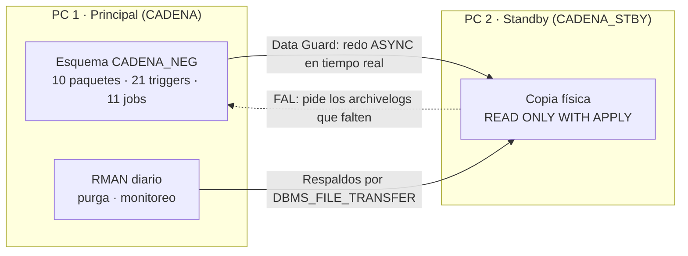

# Super Brunca · Base de datos Oracle con alta disponibilidad


Base de datos completa para una cadena de supermercados, construida en **Oracle Database 21c Enterprise Edition**. Toda la lógica del negocio vive dentro de la base (paquetes PL/SQL, triggers y jobs programados), y la base principal se replica en tiempo real a un **servidor standby en otra computadora con Oracle Data Guard**, con respaldos diarios con **RMAN**, purga automática, switchover y failover probados.

Proyecto del curso *Administración de Bases de Datos*, Universidad Nacional de Costa Rica, Sede Regional Brunca (2026).

---

## Lo más destacado

- **Alta disponibilidad real entre dos computadoras.** Data Guard envía cada cambio por la red (puerto 1521) y la standby lo aplica en tiempo real. En la prueba de failover, con la principal apagada de golpe, la standby tomó el control **sin perder la última venta**.
- **Respaldo y recuperación con RMAN.** Hay un respaldo diario automático (nivel 0 los domingos, nivel 1 el resto de días) que se valida y se envía a la standby por la red de Oracle. También hay una política de borrado que nunca elimina un archivelog que la standby no haya aplicado, y recuperación completa, a un punto en el tiempo o de un solo PDB.
- **Reglas del negocio en la base, no en la aplicación.** Los límites de crédito, las cuentas por cobrar y por pagar, el inventario, las devoluciones y el historial de precios se cumplen con triggers, vengan los datos de donde vengan.
- **Carga masiva del padrón nacional.** 3,76 millones de personas del TSE se cargan con tablas externas y `MERGE` por lotes, sin rechazos, y se actualizan solas cada mes.
- **Seguridad.** Hay perfiles de contraseña, roles con privilegios mínimos protegidos con clave, claves cifradas con AES-256 (`DBMS_CRYPTO`) y auditoría completa con transacciones autónomas.
- **Operación automatizada.** Hay 11 jobs de `DBMS_SCHEDULER`, notificaciones por correo desde Oracle (`UTL_SMTP` con SSL) y un monitoreo diario de la salud de la base.

## Arquitectura



Cada base corre en su propio contenedor Docker con la imagen oficial `container-registry.oracle.com/database/enterprise:21.3.0.0`. El proyecto vive en el PDB `PDBCADENA`.

## Qué incluye

| Área | Implementación |
| :--- | :--- |
| **Modelo de datos** | 9 módulos (catálogos, personas, seguridad, productos, inventario, compras, ventas, promociones, auditoría). Hay 65 tablas y 225 índices, con desnormalizaciones controladas que solo actualizan los triggers. |
| **Lógica del negocio** | Facturación a crédito con cuentas por cobrar y por pagar, abonos que cierran la factura al quedar saldada, kárdex de inventario, promociones por productos patrocinadores, descuentos semanales, premiación semestral y cierre diario por cajero. |
| **Transacciones y concurrencia** | `SAVEPOINT` y `ROLLBACK TO` en cada operación crítica. `FOR UPDATE WAIT 5` en existencias y `NOWAIT` en abonos. Cada regla tiene su propio código de error. |
| **Auditoría** | Bitácora de operaciones, valor anterior y nuevo por columna, y registro de errores con `PRAGMA AUTONOMOUS_TRANSACTION`. |
| **Seguridad** | 2 perfiles de contraseña y 4 roles con privilegios mínimos (`DEFAULT ROLE NONE`), con claves cifradas en una tabla de parámetros. |
| **Notificaciones** | Correo HTML directo desde Oracle (`UTL_SMTP`, SSL, wallet de certificados): avisos de crédito, morosidad, vencimientos, cierre diario y alertas al DBA. |
| **Monitoreo y optimización** | Tablespaces, objetos inválidos, índices dañados y sesiones. Análisis con `EXPLAIN PLAN` y 2 vistas materializadas. |
| **Standby (Data Guard)** | Redo de 50 MB con cambio de log cada 5 minutos (`ARCHIVE_LAG_TARGET`), `FORCE LOGGING`, `STANDBY_FILE_MANAGEMENT=AUTO`, aplicación en tiempo real, switchover y failover. |
| **RMAN** | Incremental nivel 0 y nivel 1 comprimido, controlfile de standby, `RESTORE VALIDATE`, retención de 14 días y purga a los 3 días solo de lo ya aplicado y respaldado. |
| **Parametrización** | Porcentajes, destinatarios, horarios y retenciones en la tabla `SEG_PARAMETRO`: se cambian sin tocar el código. |

## Resultados verificados

Todo se probó en Oracle 21c Enterprise Edition con dos contenedores:

- Instalación limpia con **0 objetos inválidos** y las **12 pruebas automáticas al 100 %**.
- **Padrón del TSE:** 3 762 240 personas cargadas, 0 rechazos.
- **Switchover** de ida y vuelta sin pérdida de datos.
- **Failover** tras `docker kill` de la principal: 0 transacciones perdidas, y luego la antigua principal se reconstruyó como standby.
- **Recuperación de un PDB** con RMAN (nivel 0 + nivel 1 + archivelogs).
- **Replicación** de la reinstalación completa del esquema a la standby con retraso 0.

## Estructura del repositorio

```
sql/
├── script_bd_v2.sql                 modelo base
├── 00_Master_Instalacion_Avance2.sql   instalador (ejecuta 01 a 07 y valida)
├── 01_Estructuras_Avance2.sql        tablas, columnas y datos semilla
├── 02_..._Notificaciones.sql         auditoría, seguridad y correo
├── 03_Paquetes_Negocio_Monitoreo.sql ventas, compras, inventario, padrón, monitoreo
├── 04_Triggers_Negocio_y_Auditoria.sql
├── 05_Seguridad_Perfiles_Roles_Usuarios.sql
├── 06_Scheduler_Optimizacion_y_Pruebas.sql
├── 08_Wallet_SMTP_Gmail.sh           wallet SSL para el correo
└── 07_Standby_y_RMAN/                Data Guard, RMAN, purga, switchover/failover
    └── docker/                       configuración de red de los contenedores
datos/padron/                         descarga del padrón del TSE y muestra
docs/
├── manuales/                         manuales de instalación, standby y técnico (.md y .pdf)
├── modelo/                           diagrama relacional, DBML y diccionario de datos
└── ...                               guías paso a paso y pruebas
menu.ps1                              menú de operación (estado, respaldo, switchover, failover...)
```

## Cómo ejecutarlo

**Requisitos:** Docker Desktop, una cuenta en el [Oracle Container Registry](https://container-registry.oracle.com) con la licencia de la imagen `database/enterprise` aceptada, y unos 3 GB de memoria por contenedor.

1. Cree `sql/07_Standby_y_RMAN/docker/oracle_ee.env` (no se versiona) y levante el contenedor de la principal. Ver [docker/README.md](sql/07_Standby_y_RMAN/docker/README.md).
2. Instale el esquema:
   ```bash
   docker exec -i -u oracle -w /opt/oracle/proyecto/sql ora_principal sqlplus -s / as sysdba '@script_bd_v2.sql'
   docker exec -i -u oracle -w /opt/oracle/proyecto/sql ora_principal sqlplus -s / as sysdba '@00_Master_Instalacion_Avance2.sql'
   ```
3. Para el standby, siga el [Manual de Administración del Standby](docs/manuales/Manual_Administracion_Standby.md).
4. Opere todo desde el menú:
   ```bash
   powershell -ExecutionPolicy Bypass -File .\menu.ps1
   ```
   El menú detecta si la PC tiene la principal o la standby y ofrece estado, sincronización, respaldo RMAN, consulta en solo lectura, switchover, failover, correos y prueba de conexión entre las dos PC. Muestra los comandos reales que ejecuta.

La guía completa, desde cero en las dos computadoras, está en [docs/GUIA_PASO_A_PASO.md](docs/GUIA_PASO_A_PASO.md).

## Documentación

- [Manual de Instalación y Despliegue](docs/manuales/Manual_Instalacion_y_Despliegue.md)
- [Manual de Administración del Standby](docs/manuales/Manual_Administracion_Standby.md)
- [Manual Técnico de Administración y Mantenimiento](docs/manuales/Manual_Tecnico_de_Administracion_y_Mantenimiento.md)
- [Modelo relacional y diccionario de datos](docs/modelo/README.md)

## Nota sobre credenciales

Las contraseñas de los usuarios de ejemplo y la llave AES que aparecen en los scripts son **valores de demostración** para que el proyecto se pueda instalar y probar sin pasos extra. En un entorno real se reemplazan y la llave se guarda en un Oracle Wallet o en un gestor de secretos (ver el Manual Técnico). La clave de la base (`oracle_ee.env`) y la clave de Gmail no se versionan.

## Autores

**Keylor Pineda Alvarez** · **Diego Bonilla Mora**
